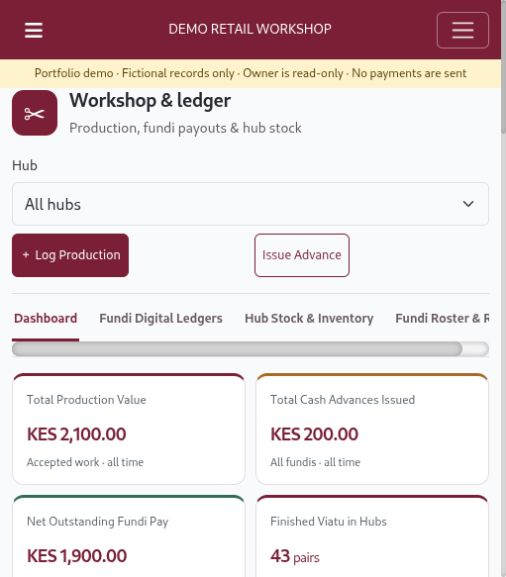

# Retail Workshop POS Demo

A sample shop and workshop app built with Laravel. You can make a sale, print a receipt, move stock between shops and record workshop jobs.

All names, products, payments and records are made up. Payments are recorded only; the app does not move money.



*Recording workshop jobs and checking worker balances with sample data.*

## About this project

This demo brings a shop sale and the work behind it into one app: selling an item, moving stock and keeping track of workshop earnings. Try a sale as a cashier, then switch to a manager to follow the stock and workshop records.

## Try the demo

Use one of these accounts. The password for all four is **`DemoWorkshop2026!`**.

| Username | What you can do |
|---|---|
| `cashier` | Search products, make a sale, print receipts and refund sales |
| `manager` | Manage stock, hub deliveries and workshop jobs |
| `south-cashier` | Receive the sample delivery at the second shop |
| `owner` | View reports and switch shops; this account is read-only |

These are public demo accounts. Use them only with sample data. Follow the [five-minute walkthrough](docs/WALKTHROUGH.md) if you want a place to start.

## Run it on your computer

You need PHP 8.2+, Composer 2, Node 22.12+, npm and MariaDB 10.11+ or a compatible MySQL server. PHP also needs mbstring, XML/DOM, fileinfo, PDO MySQL, sodium, curl and OpenSSL.

Create an empty database called `retail_workshop_demo` and a database user that can access only that database. Do not use a business database.

From this project's folder, run:

```sh
cp .env.example .env
```

Open `.env` and enter your demo database host, name, username and password. Keep `DEMO_MODE=true` and `APP_DEBUG=false`. Then run:

```sh
composer install
npm ci --ignore-scripts
npm run build
php artisan key:generate
php artisan migrate --seed
php artisan serve
```

Open [http://127.0.0.1:8000](http://127.0.0.1:8000) and sign in with a demo account. The build includes the browser libraries and fonts.

Setup adds two shops, two hubs, 12 product variants, four accounts, sample sales, workshop jobs, an advance and a pending delivery. It refuses to add this data if users, products or orders already exist.

## What to expect

Cashiers use catalog prices. Managers can change the price on a sale. A shop can sell an item even when its stock is zero, so stock can become negative. Shoe assembly uses pooled uppers; soles are left out of this simplified example.

The app also includes combined cash/Paybill records, partial refunds, stock requests, delivery tracking, workshop earnings and reports. Backups, cloud connections, imports and shared-account administration are disabled in demo mode.

## Start over

**This deletes the records in your configured demo database and clears the app's file sessions.** Check your `.env` before running it.

```sh
php artisan demo:reset --force
```

Reset works only when demo mode is on and the database name ends in `_demo`. That name is a safeguard; you still need to check that you selected the right database.

## Run the checks

Build the assets first, then run:

```sh
php artisan test
node tools/test-pos-search.cjs
python3 tools/test-backup-archive.py
composer audit --locked
npm audit
```

For database checks and the previous results, see [the testing guide](docs/VERIFICATION.md).

## Sharing the app

This GitHub repository shares the code. It does not provide a live website.

Hosting needs a separate disposable database, a fresh application key, HTTPS, secure cookies and a web server pointing at `public/`. Keep mail and cloud services disconnected. Visitors share the sample records and can change them. Take the app offline before resetting shared data.

Read [security and hosting notes](SECURITY.md) before putting it online. [How the app works](docs/ARCHITECTURE.md) explains the code.

## Credits

This is a separate demo adapted from the author's earlier retail app, with fresh Git history and fictional data. The original business database, credentials, uploads, branding and documents are excluded.

See [third-party credits](THIRD_PARTY_NOTICES.md) for Laravel, the admin template and other libraries. Their licenses still apply. This repository does not add a blanket license for all application code or assets.
