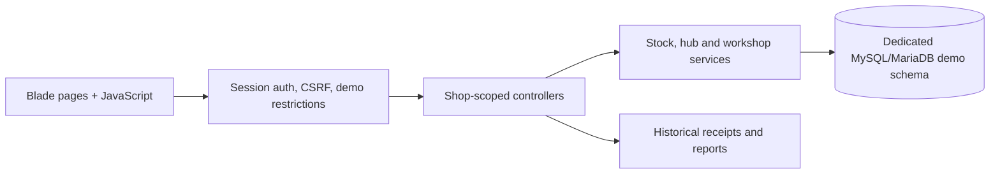

# Retail Workshop POS Demo

A Laravel portfolio project connecting **shop sales, inventory transfers and workshop production**. Every shop, customer, worker, payment reference and catalog entry in the sample dataset is fictional.

This is an educational demonstration, with a read-only owner account and usable cashier/manager workflows. It does not send payments, connect to a real business, or provide production accounting guarantees.

## Explore

| Username | What to try |
|---|---|
| `cashier` | Search products, make a sample sale, print a receipt, refund a sample transaction |
| `manager` | Receive/count stock, manage hub deliveries, record workshop production and fictional ledger payments |
| `south-cashier` | Receive the seeded hub delivery into the second demo shop |
| `owner` | Read-only overview, reports and shop switching |

All fixture accounts use **`DemoWorkshop2026!`**. This is an intentionally public sample password. Use these accounts only with the isolated synthetic dataset. Do not enter personal or real business information.


## Features

- Shop-specific inventory and cart isolation, with cashier/manager/owner permissions.
- Product search tolerant of typos, missing spaces, size variants and product codes.
- Cash and Paybill **recordkeeping**, combined tender, thermal receipts and partial/full refunds.
- Stock requests with reservations, confirmation, dispatch and receipt transitions.
- Hub inventory and audited delivery/transfer events.
- Workshop tailoring, upper making, pooled-upper shoe assembly, and fundi earnings/advance/payout ledgers.
- Historical receipt snapshots, payment summaries, filtered history and reports.
- Transaction locking, idempotent workflow requests and regression tests.

Cashiers sell at server-derived catalog prices. Managers may override sale-line prices. Catalog edits and sale-line overrides are separate operations. Existing zero-stock selling is intentional; quantity updates are transactional, but shop balances can become negative. Assembly consumes pooled uppers without soles, reflecting the demo's simplified manufacturing rule.

## Local setup

Requires **PHP 8.2+**, Composer 2, **Node 22.12+** and npm, Python 3, and **MariaDB 10.11+** or a compatible MySQL server. PHP needs mbstring, XML/DOM, fileinfo, PDO MySQL, sodium, curl and OpenSSL. The integration tools additionally need local `mariadbd`, `mariadb-install-db` and `mysql` commands.

Use a dedicated database and database account. Never point this demo at an existing business database. For example, provision `retail_workshop_demo` and a user restricted to that schema using your database administration tool.

```sh
cp .env.example .env
# Edit .env: set your dedicated DB host, user and password.
composer install
npm ci --ignore-scripts
npm run build
php artisan key:generate
php artisan migrate --seed
php artisan serve
```

Open [the local app](http://127.0.0.1:8000). Browser libraries/fonts are copied from locked npm dependencies by the build; no missing local vendor folder or proprietary graphics are required. `APP_DEBUG=false` and `DEMO_MODE=true` are the defaults. Keep demo mode enabled.

The seeder refuses to run if users, products or orders already exist. It creates two shops, two hubs, 12 fictional product variants, four sample accounts, sales history, three workshop production entries, a sample advance and a pending hub delivery.

### Reset the disposable dataset

```sh
php artisan demo:reset --force
```

This command refuses unless demo mode is on and the configured database name ends in `_demo`. It **replaces that demo database**, then clears this application's file sessions. It does not reset through an HTTP endpoint. Only run it against your disposable schema.

## Verify

Build assets before running feature tests. The unit/feature suite includes isolated mock-based cases; database integrity tests separately create temporary MariaDB instances with private sockets and no network listeners.

```sh
php artisan test
node tools/test-pos-search.cjs
python3 tools/test-backup-archive.py
APP_ENV=testing DEMO_MODE=true php tools/test-demo.php
APP_ENV=testing DEMO_MODE=false php tools/test-workshop.php
APP_ENV=testing DEMO_MODE=false php tools/test-stock-transfers.php
APP_ENV=testing DEMO_MODE=false php tools/test-hubs.php
APP_ENV=testing DEMO_MODE=false php tools/test-refund-integrity.php
composer audit --locked
npm audit
```

The feature suite explicitly selects non-demo configuration for inherited controls, while dedicated demo tests turn the restrictions on. The non-demo setting in isolated integration commands is for regression testing only, not public hosting. [Verification evidence](docs/VERIFICATION.md) records the latest local checks.

## Architecture



Read [architecture and invariants](docs/ARCHITECTURE.md), [the demo walkthrough](docs/WALKTHROUGH.md), and [security boundaries](SECURITY.md).

## Hosting boundaries

Publishing this source repository does not deploy a website. To host it, use a separate disposable database, fresh application key and session cookie, HTTPS and secure cookies, built static assets, and a restricted runtime identity. Never run a Vite development server publicly.

Demo mode blocks all backup/recovery/cloud routes before authentication, blocks shared-account administration and imports, and makes the owner account read-only except shop switching/logout. Recovery CLI operations and backup schedules are disabled. No original database, credentials, uploads, photos, logos, backup archives, deployment paths or Git history are included.

If you run a shared demo, schedule an external reset task after closing traffic, add host resource limits, and keep mail/cloud services disconnected. Users can mutate fictional shop/workshop records, so the public database is not durable or trusted. See `SECURITY.md` for limits.

## Provenance and licensing

Adapted from the author's earlier retail application into a separate synthetic portfolio project with fresh history. Frameworks, libraries and template influences are credited in [THIRD_PARTY_NOTICES.md](THIRD_PARTY_NOTICES.md). This repository does not grant a new blanket license over application code or third-party assets; dependencies retain their own licenses. No business endorsement is implied.
